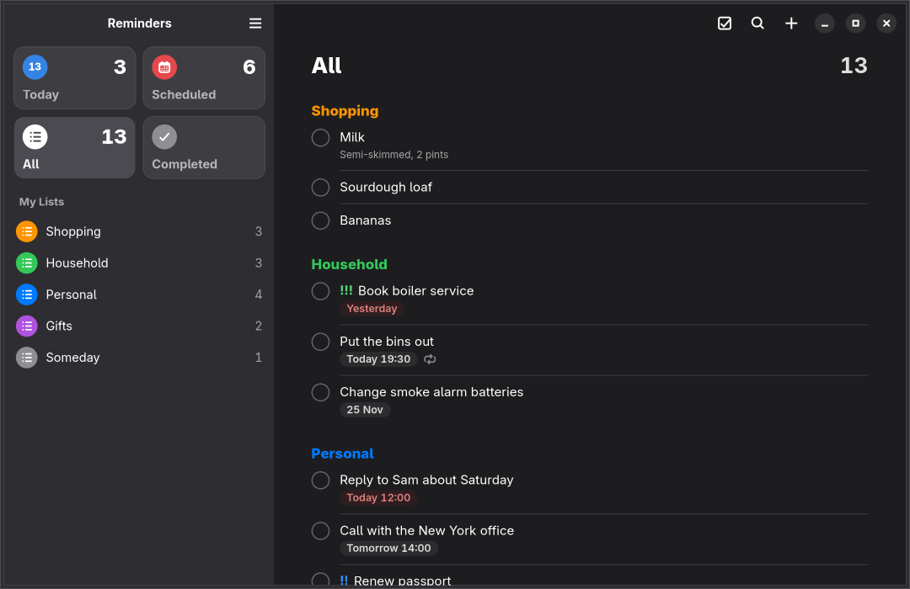
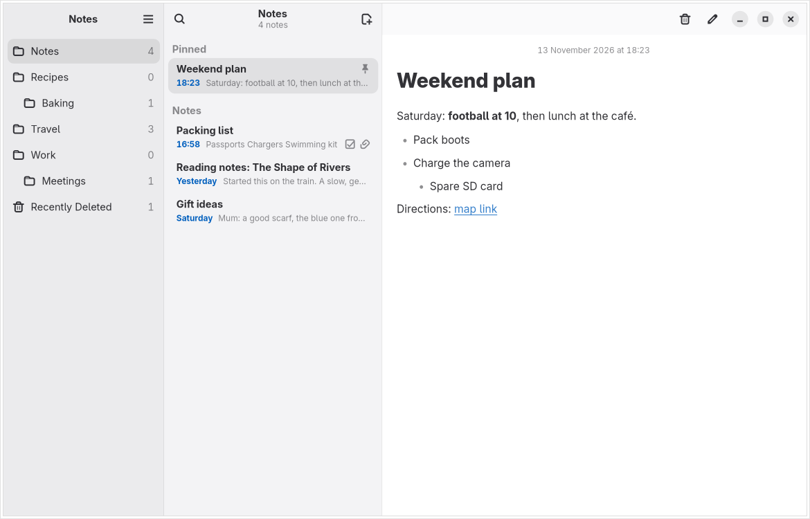

# Fruity Bridge

Your Apple Reminders and Apple Notes on Linux, served by your own Mac over your Tailscale tailnet.




An always-on Mac runs a small menu-bar app that reads Reminders and Notes locally and serves them
over HTTPS on your tailnet. Two native GTK4 + libadwaita apps, **Reminders** and **Notes**, talk to
it from Linux. They work on GNOME, Hyprland, niri and any other Wayland desktop. No Apple ID
password, iCloud cookie or third-party cloud service is involved: everything stays on your Mac,
your Linux machines and your tailnet.

```
 Linux (GTK apps) ──HTTPS over Tailscale──▶ tailscale serve ──▶ Fruity Bridge.app (127.0.0.1)
                                                                  ├─ EventKit → Reminders
                                                                  ├─ NoteStore.sqlite → Notes (read)
                                                                  └─ AppleScript → Notes (write)
```

## What works

**Reminders:** lists, Today / Scheduled / All / Completed, create, edit (title, notes, due date and
time, priority, URL), complete and delete, with live updates.

**Notes:** folders, search, and reading notes with their formatting (headings, lists, checklists,
tables, quotes, monospace, links, images and attachments). You can create notes and edit plain
ones. Notes with checklists, attachments, tags, mentions, note links or quotes are read-only on
Linux, because saving through AppleScript would lose those parts. Locked notes stay locked.

Both apps keep a local copy, so they open instantly and still show your data when the Mac is
offline. Changes made elsewhere reach the apps within seconds.

## Requirements

- A Mac that stays on and logged in (macOS 14 or later), with the Command Line Tools
  (`xcode-select --install`) and the Tailscale app.
- Linux machines on the same tailnet with GTK 4.20 and libadwaita 1.8 or later.
- [Tailscale HTTPS certificates](https://tailscale.com/kb/1153/enabling-https) enabled for the
  tailnet.

## Setup

### 1. The Mac

```sh
git clone https://github.com/subsy/fruity-bridge && cd fruity-bridge/mac
./make-signing-identity.sh   # once: a stable local signature so macOS keeps the app's permissions
./install.sh --start         # build, self-test, install to /Applications, start, tailscale serve
```

`install.sh` publishes the bridge on `https://<mac-name>.<tailnet>.ts.net:10000`. Only the
Tailscale login the Mac is signed in with may use it; allow another with
`"/Applications/Fruity Bridge.app/Contents/MacOS/FruityBridge" --allow-login someone@example.com`.

Then grant three permissions from the bridge's menu-bar icon: Full Disk Access (to read Notes),
Reminders, and Automation for Notes (to save notes). [mac/README.md](mac/README.md) has the exact
steps.

### 2. Linux

On Arch Linux, build and install both apps from the PKGBUILD:

```sh
cd packaging/arch && makepkg -si
```

Elsewhere, build with Cargo (needs the GTK 4 and libadwaita development packages):

```sh
cargo build --release -p fruity-reminders -p fruity-notes
```

The first time an app starts, it asks for the bridge address shown in the Mac's menu. The address is
saved to `~/.config/fruity-bridge/config.toml`, which both apps share.

## Security

- The bridge listens on `127.0.0.1` only. `tailscale serve` is the only way in, so it's reachable
  only from your tailnet, over HTTPS.
- Each request must carry the `Tailscale-User-Login` header that `tailscale serve` adds, and the
  login must be on the bridge's allow list. A random path secret, known only to the bridge and
  `tailscale serve`, stops other processes on the Mac from forging that header.
- Requests from web browsers (with `Origin`/`Sec-Fetch-*` headers) and unknown `Host` names are
  refused.
- Note writes pass text to AppleScript as event parameters, never spliced into script source.

## Development

`linux/mock/mock_bridge.py` is a standard-library mock of the API with sample data:

```sh
python3 linux/mock/mock_bridge.py &
FRUITY_BRIDGE_URL=http://127.0.0.1:47399 cargo run -p fruity-notes
```

[docs/api.md](docs/api.md) describes the HTTP API. `mac/build.sh` builds the Mac app with `swiftc`
and runs its self-tests. Xcode isn't needed.

## Credits

Notes' storage format comes from the work of the
[apple_cloud_notes_parser](https://github.com/threeplanetssoftware/apple_cloud_notes_parser)
project.

Fruity Bridge isn't affiliated with or endorsed by Apple. Apple, Apple Notes, Reminders and macOS
are trademarks of Apple Inc.

## License

[MIT](LICENSE)
